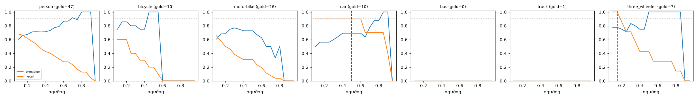

# Báo cáo Day 08 — 2A202603307 - Phạm Minh Quân

> Báo cáo tổng hợp recipe, số đo review, calibration và QC. Các phần bổ sung có hỗ trợ của Codex dựa trên file nguồn; phạm vi hỗ trợ và những việc chưa được xác nhận được ghi ở mục 8.

## 1. Model và recipe (Part 2–3)

| Lớp          | Model + cỡ                                | Ngưỡng           | Căn cứ từ threshold_sweep                                                                                                                        |
| ------------- | ------------------------------------------ | ------------------ | --------------------------------------------------------------------------------------------------------------------------------------------------- |
| person        | YOLO26m                                    | 0.30 (mặc định) | Không ngưỡng nào trong khoảng quét 0.10–0.50 đạt recall 90%; recall cao nhất là 32/47 = 68.1% tại 0.10.                                 |
| bicycle       | YOLO26m                                    | 0.30 (mặc định) | Không đạt mục tiêu recall 90%; recall cao nhất là 6/10 = 60.0% trong khoảng 0.10–0.50.                                                     |
| motorbike     | YOLO26m                                    | 0.30 (mặc định) | Không đạt mục tiêu recall 90%; recall cao nhất là 17/26 = 65.4% tại 0.10 trong khoảng 0.10–0.50.                                          |
| car           | YOLO26m                                    | 0.50               | Ngưỡng cao nhất không vượt 0.50 vẫn đạt recall 9/10 = 90.0%; precision 9/13 = 69.2%.                                                       |
| bus           | YOLO26m                                    | 0.30 (mặc định) | Gold không có bus (0 vật), không đủ dữ liệu để chọn ngưỡng hoặc đánh giá recall của lớp.                                         |
| truck         | YOLO26m                                    | 0.30 (mặc định) | Gold chỉ có 1 vật (< 5), không đủ mẫu để chọn ngưỡng riêng.                                                                            |
| three_wheeler | YOLOE-26s, prompt mặc định từ taxonomy | 0.15               | Ngưỡng cao nhất không vượt 0.50 vẫn đạt recall ít nhất 90%: 7/7 = 100%; precision 7/9 = 77.8%. Tại 0.20, recall giảm còn 6/7 = 85.7%. |

### Kết quả quét ngưỡng trên 4 ảnh gold

Nguồn: `qc/threshold_sweep.csv`, `qc/threshold_sweep.md` và `qc/threshold_sweep.png`. Script đề xuất ngưỡng cao nhất không vượt 0.50 còn đạt recall ít nhất 90%; lớp có dưới 5 vật gold không được chọn ngưỡng riêng. Các lớp không đạt mục tiêu giữ mặc định 0.30 theo cơ chế dự phòng của script, không có nghĩa ngưỡng này đạt recall 90% hoặc là ngưỡng tối ưu.

| Lớp          | Ngưỡng áp dụng | TP | FP | FN | Precision = TP/(TP+FP) | Recall = TP/(TP+FN)             |
| ------------- | ------------------ | -- | -- | -- | ---------------------- | ------------------------------- |
| person        | 0.30               | 25 | 10 | 22 | 25/35 = 71.4%          | 25/47 = 53.2%                   |
| bicycle       | 0.30               | 4  | 1  | 6  | 4/5 = 80.0%            | 4/10 = 40.0%                    |
| motorbike     | 0.30               | 10 | 3  | 16 | 10/13 = 76.9%          | 10/26 = 38.5%                   |
| car           | 0.50               | 9  | 4  | 1  | 9/13 = 69.2%           | 9/10 = 90.0%                    |
| bus           | 0.30               | 0  | 1  | 0  | 0/1 = 0%               | Không xác định: 0 vật gold |
| truck         | 0.30               | 0  | 2  | 1  | 0/2 = 0%               | 0/1 = 0% (mẫu quá ít)        |
| three_wheeler | 0.15               | 7  | 2  | 0  | 7/9 = 77.8%            | 7/7 = 100%                      |



Biểu đồ thể hiện recall của person, bicycle và motorbike giảm khi tăng ngưỡng. Với car, tăng ngưỡng từ 0.30 lên 0.50 giữ nguyên 9 TP và 1 FN, đồng thời giảm FP từ 6 xuống 4. Với three_wheeler, ngưỡng 0.15 giữ đủ 7 vật gold nhưng vẫn có 2 FP. Đây là các số đo của phép quét trước bước gộp pre-label; số đo sau gộp sẽ được tính riêng ở Part 4.

Chuỗi tham số script đề xuất để dùng ở Part 4:

```text
python scripts/merge_prelabels.py work/prelabel/yoloe_all/pre.coco.json work/prelabel/y26_all/pre.coco.json --thr "car=0.5,three_wheeler=0.15" --conf 0.3 --iou 0.6 --split "batch,gold" --out work/prelabel/merged_review/pre.coco.json
```

- Lệnh `merge_prelabels.py` đã dùng (dán nguyên): python scripts/merge_prelabels.py work/prelabel/yoloe_all/pre.coco.json work/prelabel/y26_all/pre.coco.json --thr "car=0.5,three_wheeler=0.15" --conf 0.3 --iou 0.6 --split "batch,gold" --out work/prelabel/merged_review/pre.coco.json
- **Phiên bản SAM bạn chọn** (SAM 1 / 2.1 / 3) và lý do: Tôi chọn SAM 2.1 tiny (`sam2.1_t.pt`) chạy trên CPU. Lượt kết hợp YOLO26m và SAM trên hai ảnh mất khoảng 11,5 giây, phù hợp với máy RAM 8 GB.
- **Lỗi không sửa được chỉ bằng đổi ngưỡng:** theo `model_log.csv`, YOLO26m gọi tuk-tuk thành truck ở `img_002`, xích lô thành motorbike ở `img_007`; lượt detector kết hợp SAM còn gọi tuk-tuk thành car ở `img_013`. Tăng ngưỡng có thể xóa box sai nhưng **không biến nó thành nhãn `three_wheeler`**. Recipe dùng YOLOE bổ sung lớp này; khi review vẫn phải đối chiếu guideline, sửa lớp và hình học hoặc vẽ thêm vật bị bỏ sót. SAM hỗ trợ tạo mask, không tự sửa lớp của detector.
- **Ví dụ box điểm thấp nhưng khớp gold:** trong kết quả YOLO26m `work/prelabel/y26_all/pre.coco.json`, box motorbike **#1650** ở `img_036.jpg` có **conf = 0.1165**, bbox COCO `[471.29, 327.49, 173.20, 247.41]` (x, y, rộng, cao). Khi ghép cùng lớp, một-một theo cách của script ở ngưỡng conf 0.10 và IoU tối thiểu 0.50, box này khớp motorbike **#95** trong `labels/gold_manual.json` với **IoU = 0.9636**. Ngưỡng mặc định 0.30 loại box này dù nó khớp gold. Đây là ví dụ đúng theo tiêu chí so khớp với gold hiện có, không phải xác nhận độc lập rằng gold hoàn toàn chính xác; conf cũng không thay thế kiểm tra lớp và hình học. Nhận xét trong log về các box sai còn tồn tại ở lượt conf 0.50 không cung cấp điểm cụ thể từng box, nên không gán một giá trị conf suy đoán cho chúng.
- Giới hạn: ngưỡng được chọn và đánh giá trên cùng 4 ảnh gold, nên precision/recall ở ngưỡng đã chọn có thể lạc quan và chưa chứng minh khả năng tổng quát hóa trên batch. Ngưỡng chỉ là ước lượng từ mẫu nhỏ; bus có 0 vật, truck có 1 vật nên chưa đủ cơ sở chọn ngưỡng riêng. Recall 7/7 = 100% của three_wheeler chỉ đúng trên mẫu gold này, không bảo đảm không bỏ sót trên ảnh khác.

## 2. AI error profile (từ `qc/review_stats.md`)

| Trạng thái | Số | Tỉ lệ | Mẫu số                     |
| ------------ | --- | ------- | ---------------------------- |
| accepted     | 472 | 93,5%   | 505 box máy                 |
| edited       | 5   | 1,0%    | 505 box máy                 |
| deleted      | 28  | 5,5%    | 505 box máy                 |
| added        | 7   | 1,4%    | 484 đối tượng sau duyệt |

- **Phạm vi và mẫu số:** bảng trên tính trên 24 ảnh batch, sau khi script loại **24 đối tượng nằm quanh bẫy** để lỗi nhân tạo không bị tính thành lỗi tự nhiên của máy. Vì thế 484 đối tượng trong profile không phải tổng nhãn batch; bản batch và release hiện có **497 đối tượng**. Đây là so sánh pre-label với nhãn sau review, không phải phép chấm trên gold độc lập của toàn bộ batch.
- **Lớp cần sửa nhiều nhất theo profile batch là `three_wheeler`:** có **41 box máy = 14 accepted + 5 edited + 22 deleted**; tỉ lệ deleted là **22/41 = 53.7%**, edited **5/41 = 12.2%**, accepted **14/41 = 34.1%**. Lớp này chiếm **22/28 = 78.6%** tổng box deleted và **5/5 = 100%** tổng box edited; có thêm 3 đối tượng added. `model_log.csv` ghi các ca khó cụ thể: `img_002` tuk-tuk bị YOLO26m gọi truck, `img_007` xích lô bị gọi motorbike; ở lượt YOLOE pilot, `img_011` có nhận nhầm xe tải và `img_032` còn sót nhiều xích lô. Những quan sát này cho thấy cả phân lớp, box thừa và bỏ sót đều cần kiểm tra. Tuy nhiên các ví dụ pilot không giải thích riêng từng box trong 22 box bị xóa của batch; không coi toàn bộ deleted là sai lớp hoặc tự quy kết nguyên nhân cho từng box.
- **Phân biệt thêm mới và đổi lớp:** `qc/review_stats.md` xác định **3 trường hợp đổi lớp** trong các cặp deleted + added. Vì vậy **7 added không đồng nghĩa 7 vật bị máy bỏ sót**; số sót thật theo cách ghép của script xấp xỉ **7 − 3 = 4**. Con số này vẫn phụ thuộc nhãn sau review: nếu cả máy lẫn người đều bỏ sót một vật, profile không tự phát hiện được.
- **Không có một lớp tệ nhất theo mọi tiêu chí:** trên gold ở ngưỡng áp dụng, motorbike có recall **10/26 = 38.5%**, thấp hơn person **25/47 = 53.2%** và bicycle **4/10 = 40.0%**. Truck có recall **0/1 = 0%** nhưng chỉ một vật, còn bus không có vật gold nên không đánh giá recall. Nhận định về three_wheeler ở trên nói về mức sửa/xóa trong batch; không mâu thuẫn với recall **7/7 = 100%** trên gold của phép quét trước gộp, vì khác tập ảnh và phạm vi đo.
- So với gold: precision / recall của **máy** Trên 4 ảnh gold, model có 55 TP, 18 FP và 46 FN. Precision là 55/73 = 75,3%; recall là 55/101 = 54,5%. Ngưỡng được chọn trên chính gold nên đây là đánh giá trong mẫu.

## 3. Thiên kiến tự động hóa và ảnh bẫy

### Ghi nhận vòng đầu và vòng sửa có đáp án

- Vòng đầu, trước lần hỗ trợ sửa này: script ghi nhận bắt được **3/12 bẫy = 25.0%** (loose 1/3, missing 1/3, extra 0/3, wrong_class 1/3). Bản export và báo cáo vòng đầu được giữ tại `history/trap_assisted_round2/batch_reviewed_round1.json` và `history/trap_assisted_round2/review_stats_round1.{json,md}`.
- Sau vòng sửa, chạy lại script ghi nhận **12/12 bẫy = 100.0%**. Đây là kết quả khắc phục có hỗ trợ AI và đã xem đáp án, **không phải tỉ lệ bắt bẫy độc lập** của người học; số vòng đầu 3/12 vẫn được giữ để phân tích quá trình review.
- Bắt bẫy vòng đầu: **3/12 = 25.0%**. Tôi bắt được 1/3 bẫy box lệch (`loose`), 1/3 bẫy bỏ sót (`missing`), 0/3 bẫy box thừa (`extra`) và 1/3 bẫy sai lớp (`wrong_class`); còn lọt lần lượt 2, 2, 3 và 2 bẫy. Kết quả cho thấy vòng review đầu chưa kiểm soát tốt cả bốn loại lỗi, đặc biệt là box thừa. Nguyên nhân có thể là tôi còn nhìn theo các box có sẵn và chưa kiểm tra đủ kỹ từng bước quét ảnh, tìm vật sót, tìm box thừa, kiểm tra lớp và độ sát của box. Số đo này không xác định chắc tôi đã bỏ qua bước checklist nào; đây là khả năng cần tự đối chiếu lại với cách tôi thực sự review.
- Accepted cao nhưng bắt bẫy thấp: vòng đầu có **472/505 box máy được giữ nguyên = 93.5%**, trong khi chỉ bắt được **3/12 bẫy = 25.0%**. Accepted đo mức độ giữ nguyên nhãn máy, không chứng minh các box được giữ đều đúng; bảng này còn loại vùng quanh bẫy nên hai tỉ lệ có phạm vi tính khác nhau. Sự chênh lệch cảnh báo nguy cơ tôi chấp nhận gợi ý của máy quá dễ dàng, nhưng chưa đủ để khẳng định nguyên nhân chỉ là thiên kiến tự động hóa. Vì vậy, tôi không dùng accepted cao làm bằng chứng chất lượng nhãn và cần tăng cường quét ảnh trước khi hiện nhãn, kiểm tra theo đủ bốn bước, kể cả với box có điểm tin cậy cao.

## 4. Máy có đáng dùng không?

- Thời gian (từ `time_log.csv`): gán tay **19 phút/4 ảnh = 4.75 phút/ảnh**; review có pre-label vòng đầu **40 phút/24 ảnh = 1.67 phút/ảnh**. Thời gian thao tác trên mỗi ảnh giảm khoảng **64.9%**, tính bằng `(1 - (40/24)/(19/4)) × 100%`. Đây chỉ là so sánh thời gian gán tay với review vòng đầu, chưa tính thời gian cài đặt, chạy model, sửa bổ sung và QC. Hai tập ảnh có độ khó và số đối tượng khác nhau; tôi đã gán gold trước nên quen cảnh và thao tác hơn khi review batch. Vì vậy, mức giảm này chưa chứng minh toàn bộ quy trình tiết kiệm 64.9% ở chất lượng tương đương.
- Kết luận: pre-label **có ích để tạo nhãn ban đầu, nhưng chưa đủ cơ sở khẳng định quy trình đã tiết kiệm thời gian ở chất lượng đạt yêu cầu**. Review vòng đầu nhanh hơn gán tay, song chỉ bắt được **3/12 bẫy = 25.0%**; accepted **472/505 = 93.5%** chỉ phản ánh nhiều box được giữ nguyên. Trên gold, máy có precision **55/73 = 75.3%** và recall **55/101 = 54.5%**, cho thấy vẫn cần tìm vật bị bỏ sót và sửa box sai. Tôi sử dụng YOLO26m làm gợi ý cho các lớp COCO và YOLOE bổ sung `three_wheeler`, đồng thời kiểm tra theo guideline trước khi chấp nhận. Kết quả 12/12 sau khi xem đáp án và có hỗ trợ AI chỉ phản ánh việc khắc phục bẫy, không thay thế đánh giá độc lập về chất lượng hoặc hiệu quả thời gian. Cần tính cả thời gian sửa và hoàn thành QC trước khi kết luận lợi ích của toàn bộ quy trình.
- **Ba quy tắc giảm thiên kiến của bạn** (mỗi quy tắc kiểm tra được bằng số hoặc việc làm):
  1. Trong các vòng review tiếp theo, tôi sẽ ẩn toàn bộ nhãn, quét đủ bốn vùng và tự xác định các vật theo lớp trước khi hiện box ở **100% ảnh**; ghi lại ảnh đã thực hiện trong nhật ký review.
  2. Tôi sẽ kiểm tra từng ảnh theo thứ tự **bỏ sót → thừa → sai lớp → box lỏng/lệch**, đánh dấu hoàn thành đủ bốn bước trong nhật ký; mọi box điểm cao vẫn phải đối chiếu với ảnh thật.
  3. Sau mỗi **8 ảnh**, tôi sẽ nghỉ **3–5 phút**, rồi kiểm tra lại một ảnh của nhóm vừa duyệt; ghi tên ảnh, lỗi phát hiện thêm và thời gian kiểm tra. Đây là kế hoạch cải thiện cho vòng sau, không phải mô tả việc đã làm ở vòng đầu.

## 5. Mask SAM cho 3 vật (Part 5)

Ba kết quả chính dùng **SAM 2.1 tiny (`sam2.1_t.pt`), chạy CPU** bằng `scripts/sam2_points.py`. Với `img_013.jpg`, giữ bản đầu có 2 click dương và 1 click âm; không dùng các bản thử v2/v3 hoặc MobileSAM làm sản phẩm chính. Số click dưới đây là số điểm trong lần chạy tạo ảnh được giữ, không phải tổng số lần thử.

| Ảnh và vật được chọn                                                                       | SAM (phiên bản) | Số click                                                    | Mask gồm người lái / hàng hoá?                                                                                               | Quan sát trên ảnh kết quả                                                                                                                                                                                                                               | File trong `masks/`                       |
| ------------------------------------------------------------------------------------------------- | ----------------- | ------------------------------------------------------------ | ---------------------------------------------------------------------------------------------------------------------------------- | ------------------------------------------------------------------------------------------------------------------------------------------------------------------------------------------------------------------------------------------------------------ | ------------------------------------------- |
| `img_004.jpg`: tuk-tuk nhìn từ phía trước, nằm giữa nhóm xe bên trái                  | SAM 2.1 tiny      | 1 dương tại (300,400), không có điểm âm              | Không thấy dính rõ người đứng bên cạnh; không có hàng hoá riêng cần đánh giá trong vật được chọn.          | Mask phủ phần lớn mái, thân và bánh xe; còn một số khe/vùng nhỏ trên thân chưa được phủ. Chưa đo sai lệch biên theo pixel, nên chưa xác nhận đạt dung sai guideline.                                                            | [tuktuk_img004.jpg](masks/tuktuk_img004.jpg) |
| `img_013.jpg`: tuk-tuk nhìn ngang, có người lái                                            | SAM 2.1 tiny      | 3: 2 dương tại (400,480), (600,110); 1 âm tại (720,300) | Còn dính một phần áo người lái và các vùng người/nền nhìn xuyên qua khoang xe; chưa tách sạch xe khỏi người. | Mask phủ mái, thành xe và bánh sau, nhưng thiếu một số phần đầu xe/bậc chân và còn nhiều vùng thừa, thiếu quanh khung xe. Click âm chưa loại hết người.                                                                            | [tuktuk_img013.jpg](masks/tuktuk_img013.jpg) |
| `img_017.jpg`: tuk-tuk phía sau cùng bên trái, bị người đi bộ và xe phía trước che | SAM 2.1 tiny      | 1 dương tại (100,400), không có điểm âm              | Không thấy dính rõ hai người đi bộ phía trước; không có hàng hoá riêng cần đánh giá.                           | Mask chọn vùng xe phía sau bên trái, gồm phần mái, thân sau và bánh nhìn thấy. Chỉ đánh giá phần lộ ra; không suy ra chất lượng ở phần xe bị che. Các thanh nhỏ và biên sát người/xe phía trước vẫn cần kiểm tra kỹ. | [tuktuk_img017.jpg](masks/tuktuk_img017.jpg) |

- **Đối chiếu guideline 4.2:** mask cần bám biên phần vật nhìn thấy, không gồm bóng đổ; kính xe thuộc vật. Lỗ lớn giữa khung xe cần được loại khỏi polygon, trong khi lỗ nhỏ dưới khoảng 5% diện tích vật được phép bỏ qua. Quy tắc hai vật chạm nhau phải tách riêng giúp nhận diện phần người bị dính ở `img_013` là lỗi, không phải phần xe hợp lệ. Với `img_017`, không cần tô phần xe bị người hoặc xe khác che khuất.
- **Giới hạn đánh giá:** đây là quan sát trực tiếp trên ảnh overlay, chưa đo được dung sai biên khoảng 3 px hoặc tỉ lệ diện tích lỗ. Những phần khó như khung xe mảnh, vùng kính nhìn xuyên và biên tiếp xúc người/xe cần được phân xử trong calibration; không coi mọi vùng trống trong mask là lỗi.
- **Phương thức thực hiện:** click offline bằng script; mục này không có kết quả thử Interactor trong CVAT để so sánh. Ba ảnh là bằng chứng thử SAM, không phải xác nhận cả ba mask đã đạt chất lượng nhãn cuối.

## 6. Calibration (Part 6)

- **Số ca đã ghi:** 3 dòng trong [calibration_decisions.csv](qc/calibration_decisions.csv), gồm 2 ca `loi_may` và 1 ca `cau_hoi_mo`. CAL-01 và CAL-02 áp dụng quy tắc đã có của v1.0; CAL-03 đã được chốt theo yêu cầu của người học và đưa vào guideline v1.1. Ba ca đã có quyết định, nhưng việc ghi bảng không thay thế kiểm tra nhãn cuối và QC.

| Ca     | Ảnh ví dụ và bằng chứng                                                                                                                      | Phân loại nguyên nhân                                                                                    | Xử lý và trạng thái                                                                                                                                                                                                                                                               |
| ------ | -------------------------------------------------------------------------------------------------------------------------------------------------- | ------------------------------------------------------------------------------------------------------------ | -------------------------------------------------------------------------------------------------------------------------------------------------------------------------------------------------------------------------------------------------------------------------------------- |
| CAL-01 | `img_002`, `img_007`, `img_013`; nhận xét trong `model_log.csv` về tuk-tuk/xích lô bị YOLO26m gọi thành truck, motorbike hoặc car | Lỗi phân lớp của máy so với định nghĩa đã rõ ở mục 2 và mục 5 của v1.0                      | Áp dụng nhãn three_wheeler cho các xe trong ca này theo guideline; SAM không tự sửa lớp sai của detector. Không thêm quy tắc phân lớp mới và không khẳng định mọi box batch đã được kiểm tra lại.                                                         |
| CAL-02 | `img_013`; [mask bản đầu](masks/tuktuk_img013.jpg) còn dính người và thiếu một số phần đầu xe/bậc chân                            | Lỗi phân đoạn của model so với quy tắc biên phần nhìn thấy và tách người/xe đã có          | Áp dụng mục 4.2.1 và 4.2.4 của v1.0; người nhìn thấy qua khoang hở không thuộc mask xe. Giữ ảnh làm bằng chứng giới hạn của SAM 2.1 tiny, chưa coi mask đã được sửa đạt chuẩn. Không dùng ca này để tự thay đổi quy tắc kính hoặc lỗ thủng. |
| CAL-03 | `img_002`, `img_007`, `img_011`, `img_032`; so sánh hai ngưỡng YOLO26m trong `model_log.csv` | Câu hỏi mở số 7 của v1.0 về việc dùng conf để miễn kiểm tra | Đã chốt trong v1.1: không có ngưỡng conf miễn kiểm tra bằng mắt. Conf chỉ lọc ứng viên và ưu tiên review; phải kiểm tra lớp, hình học và thuộc tính của từng box, đồng thời quét ảnh tìm vật sót. Không thay đổi ngưỡng suy luận Part 3 hoặc ngưỡng chấm. |

- **Quy tắc mới đã vào guideline v1.1:** CAL-03 đã được ghi ở mục 1 của [guideline_v1.1_calibrated.md](guidelines/guideline_v1.1_calibrated.md), kèm ảnh ví dụ và lịch sử thay đổi. CAL-01 và CAL-02 được ghi ở mục 2 để minh họa lỗi máy đối với quy tắc hiện hành, không tạo quy tắc phân lớp hoặc mask mới.

## 7. QC và quyết định (Part 6)

- **Mẫu và nguồn:** `qc/qc_sample.csv` chọn 5 ảnh ngẫu nhiên, seed 42, gồm `img_003`, `img_006`, `img_014`, `img_031`, `img_035`; có 0 ảnh `can_review` được bổ sung. Tổng mẫu là 100 đối tượng đã gán trong `release/final_det.coco.json` (bản release có 24 ảnh và 497 đối tượng). Việc không có ảnh được đánh dấu `can_review` không chứng minh không còn ca khó.
- **Người kiểm:** Codex (AI), theo yêu cầu của người học; đã đối chiếu ảnh gốc, overlay và tọa độ nhãn. Không coi đây là QC độc lập bởi người thứ hai. Phiếu chi tiết: [qc_review.csv](qc/qc_review.csv); phạm vi và giới hạn: [qc_visual_review.md](qc/qc_visual_review.md).
- **Số đo:** script ghi nhận lỗi theo đối tượng **9/100 = 9.0%**, theo ảnh **5/5 = 100.0%**, vượt ngưỡng ảnh lỗi tối đa 2%. Đây là cách đếm của script: mẫu số 100 là số đối tượng đã gán, còn lỗi bỏ sót không có ID được tính theo từng dòng; hai box lỗi trên cùng chiếc xích lô cũng được tính riêng. Không diễn giải 9/100 thành 9% số vật thật trong ảnh.

| Loại lỗi | Số ghi nhận | Ví dụ cụ thể |
|---|---|---|
| Sai vị trí/kích thước | 5 | `img_014` #130 cắt thiếu chân người đi xe; `img_031` #420 bao xuống cả bánh xe và nền phía dưới người bán hàng. |
| Bỏ sót | 2 | `img_003` thiếu xe đạp của người phía sau xe bán hàng; `img_006` thiếu một người ở nhóm bàn ăn bên phải. |
| Thừa | 2 | `img_031` #422 gán person lên mũ trưng bày; `img_035` #478 tách mui xích lô thành một xe riêng. |

- **Lỗi lặp:** sai vị trí/kích thước chiếm **5/9 lỗi = 55.6%**, đạt điều kiện cảnh báo lỗi hệ thống của script. Cần tăng cường review phần nhìn thấy của người/xe, không chỉ sửa một box riêng lẻ. Không ghi thêm lỗi sai lớp, thuộc tính hoặc mask trong phiếu detection này; điều đó không chứng minh các loại lỗi ấy không tồn tại ngoài mẫu. Lỗi mask SAM được ghi riêng ở mục 5.
- **Giới hạn mẫu nhỏ:** chỉ kiểm tra 5/24 ảnh; 5 ảnh có lỗi không đồng nghĩa toàn bộ 24 ảnh đều lỗi. Với 5/5 ảnh lỗi, cận trên 95% Wilson của tỉ lệ ảnh lỗi là khoảng **100%** theo `qc_report_auto.md`; mẫu này không đủ chứng minh đạt ngưỡng 2%. Kết quả cũng phụ thuộc khả năng quan sát của AI, chưa có bộ gold đầy đủ cho batch và chưa đo dung sai khoảng 2 px cho mọi box.
- **Script kiểm được/không kiểm được:** `validate_labels.py` kiểm cấu trúc, lớp, tọa độ, số ảnh và cảnh báo vật nhỏ. `qc_report.py` tổng hợp lỗi đã ghi trong phiếu, không tự phát hiện hoặc xác nhận hết lỗi thị giác. Các script không chứng minh box ôm sát vật, không phát hiện mọi trường hợp người và máy cùng bỏ sót, cũng không chứng minh người học đã thực hiện checklist.

**Quyết định cho bản release hiện tại: Rework**, ngày **2026-11-19**. Trong các lỗi đã ghi, chưa phát hiện vấn đề dữ liệu hoặc khoảng trống guideline bắt buộc phải giải quyết trước khi xác định lỗi, nên chưa chọn Hold cho mẫu này. Chọn Rework vì ảnh lỗi 5/5 = 100% vượt 2% và lỗi hình học lặp 5/9; chưa đủ cơ sở chọn Release. Các câu hỏi 1–6 còn mở trong guideline v1.1 vẫn phải xem xét khi sửa hoặc kiểm tra phần batch còn lại. Kết quả bẫy **12/12 sau khi đã xem đáp án** không thay thế phép đo độc lập vòng đầu **3/12**, không dùng làm bằng chứng người học đã bắt bẫy độc lập đạt 80%.

**Việc cần làm tiếp:** xác nhận các lỗi trong phiếu bằng mắt người; sửa các ảnh mẫu, rà soát lỗi tương tự trên batch và các cảnh báo box nhỏ. ID trong phiếu là ID release, cần khớp theo tên ảnh và vị trí nếu sửa nhãn batch. Lưu bản QC vòng này; cập nhật nhãn đã sửa theo quy trình `qc_fixed.json` nếu có, chạy lại `build_release.py`, lấy mẫu/kiểm tra lại và chạy `qc_report.py`. Các lỗi QC vừa ghi chưa được sửa trong nhãn release; chưa ghi nhận thời gian sửa hoặc một vòng QC đạt sau khắc phục.

## 8. Ghi chú cá nhân

- **Dùng AI để làm bài:** Codex hỗ trợ giải thích quy trình, sao chép các cột log, đọc số đo và soạn nội dung báo cáo theo yêu cầu; đồng thời hỗ trợ soạn bảng calibration và guideline v1.1. Sau export review vòng đầu, Codex đọc đáp án bẫy, đối chiếu ảnh và sửa 9 trường hợp trong `batch_reviewed.json`, giữ bản trước sửa và nhật ký tại `history/trap_assisted_round2/`, rồi chạy lại kiểm tra nhãn và review stats. Codex còn quan sát các ảnh mask và kiểm tra 5 ảnh QC, điền phiếu với reviewer là `Codex (AI)` rồi chạy script QC. Nội dung mục 7–8 được Codex hỗ trợ soạn từ các nguồn hiện có; không trình bày các quan sát của AI như một lượt kiểm tra độc lập do người học tự thực hiện.
- **Cách kiểm tra và giới hạn hỗ trợ:** đã đối chiếu file nguồn, ảnh gốc/overlay và số đo script; bản sửa bẫy có nhật ký trước/sau, các kết quả quét ngưỡng và review stats từng được tính lại để kiểm tra khớp. Tuy vậy kiểm tra định dạng không xác nhận chất lượng thị giác. Người học cần đọc lại báo cáo, tự giải thích các quyết định và xác nhận các lỗi QC; kết quả bẫy có đáp án không thay thế phép đo vòng đầu. Nhãn đã sửa trực tiếp trên đĩa cần được đồng bộ trước khi export lại từ CVAT.
- **Rà soát bổ sung ngày 2026-11-19:** Codex chạy lại `review_stats.py` và `threshold_sweep.py` vào `work/submission_audit/`; JSON/Markdown của review stats và CSV/Markdown của quét ngưỡng khớp bản trong `qc/`. Nhãn release khớp lớp, box và polygon của batch; manifest khớp 24 ảnh, 497 đối tượng. Ví dụ conf thấp ở mục 1 được đối chiếu bằng tọa độ, lớp và ghép một-một với gold; phân tích theo lớp ở mục 2 lấy từ bảng profile đã có. Các bổ sung này do AI hỗ trợ, không ghi nhận thêm một vòng review bằng mắt của người học hoặc một vòng QC mới.
- **Gold có bị nhiễm không:** theo trình tự người học báo trong cuộc trao đổi, 4 ảnh gold đã được gán tay và export trước khi chạy model lên dữ liệu bài; lệnh setup check dùng ảnh mẫu Ultralytics. Không ghi nhận việc xem pre-label gold trước khi gán xong trong cuộc trao đổi. Đây là ghi nhận theo thông tin đã cung cấp, không phải xác minh độc lập; nếu thực tế khác cần bổ sung trung thực.
- **Máy/GPU/CVAT:** Windows, CPU, RAM 8 GB; dùng môi trường Python 3.12.10 và PyTorch CPU theo log setup. Model chính là YOLO26m, YOLOE-26s và SAM 2.1 tiny. CVAT chạy local bằng Docker; hướng dẫn cài đặt đã dùng là v2.81.0, nhưng chưa xác minh lại phiên bản container đang cài. Khi kiểm tra để ghi báo cáo, Docker engine không kết nối được; điều này không xác nhận được phiên bản CVAT thực tế. Không dùng Colab.
- **Thời gian:** `time_log.csv` ghi gold_manual 19 phút/4 ảnh và batch_review vòng đầu 40 phút/24 ảnh, tương ứng 4.75 và 1.67 phút/ảnh. Chưa có log đầy đủ cho thời gian sửa có đáp án, thử lại SAM và QC; không tự bổ sung thời gian ước đoán.
- **Dùng cache `data/cache/`:** nguồn đang dùng cho chọn ngưỡng là các lần chạy local `y26_all` và `yoloe_all` có `run.json`/`work/runs.csv`, mỗi bộ đủ 36 ảnh. Không ghi nhận sử dụng cache thay cho các lượt chạy này. Hai lượt tương ứng `r05` (YOLO26m, conf 0.05) và `r06` (YOLOE-s, conf 0.05) đã được bổ sung vào `model_log.csv` ở Part 3, giữ nguyên tham số, số box và thời gian từ log gốc. Codex hỗ trợ ghi nhận xét dựa trên quét ngưỡng và đối chiếu box với gold, không phải một lượt quan sát ảnh mới của người học. `work/` là dữ liệu chạy cục bộ, không commit theo quy định bài.
- **Lỗi/vướng mắc:** lần setup đầu thiếu trọng số YOLOE, sau đó người học báo check đã OK. Trên `img_013`, SAM 2.1 tiny từng không trả mask với tổ hợp hai click âm; các lần thêm click khác cũng có thể làm dính người/nền nhiều hơn. Giữ bản mask đầu theo lựa chọn của người học. Bốn lượt thử trong log có cùng run_id `r04`, nên phải dẫn thêm model, tham số hoặc thư mục đầu ra để phân biệt; chưa xác định nguyên nhân và chưa sửa script.
- **Kế hoạch cải thiện lần sau:** áp dụng checklist ở mục 4 từ vòng review đầu, chú ý vật sót, box trên đồ vật trưng bày và ranh giới phần nhìn thấy; ghi thời gian sửa/QC riêng. Sau khi AI hỗ trợ, người học cần kiểm tra lại trên ảnh thay vì chỉ dựa vào tỉ lệ hoặc thông báo OK của script. Đây là kế hoạch, không phải xác nhận các bước ấy đã hoàn thành ở vòng đầu.
